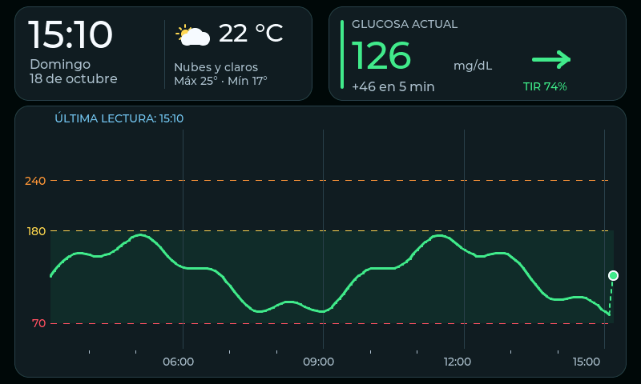
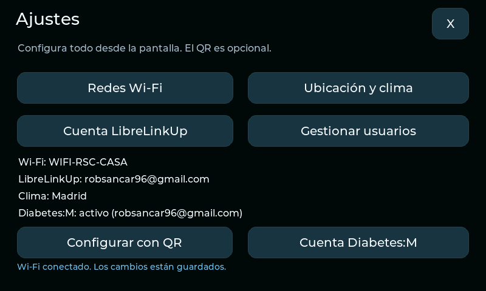

# Gluco Waveshare 2.0.0 (Estable)

Monitor de glucosa continuo en C++ para **Waveshare ESP32-S3-Touch-LCD-4.3B y 4.3B-BOX**: pantalla RGB 800×480 (controlador ST7262), panel táctil capacitivo GT911, expansor IO CH422G, flash de 16 MB y PSRAM OPI de 8 MB.

Totalmente optimizado y validado en hardware real. Sincroniza lecturas en tiempo real con **LibreLinkUp** y **Diabetes:M**, calculando métricas 24h en RAM sin desgaste de memoria flash.

| Pantalla Principal (12h de gráfica + TIR 24h + Clima) | Menú de Ajustes Táctil |
|:---:|:---:|
|  |  |

---

## Características Principales

- **Sincronización Dual (LibreLinkUp + Diabetes:M):** Consulta periódica cada 2 minutos a la API de LibreLinkUp y reenvío automático de la lectura a Diabetes:M para un registro médico continuo.
- **Métricas y TIR 24h en RAM:** Mantiene en memoria hasta 288 lecturas (24 horas completas) para calcular el Tiempo en Rango (TIR), media glucémica, mínimo, máximo y desgloses. **Cero desgaste de flash NVS** en funcionamiento continuo (respaldo periódico horario y al reiniciar).
- **Resiliencia de Red Wi-Fi:** Detección automática y reconexión inmediata en segundo plano ante microcortes, cambios de canal o caídas del router sin congelar la pantalla.
- **Gráfica de Alta Definición:** Área gráfica ampliada a **265 px** de altura (198 px de trazado útil) con límites hipo/hiperglucémicos configurables, flechas vectoriales de tendencia y codificación de colores según rango.
- **Arquitectura Asíncrona Dual-Core:**
  - **Core 1:** Renderizado RGB a 60 fps con LVGL 8, doble búfer en PSRAM, bounce buffers en SRAM interna y gestión táctil/iluminación sin interrupciones.
  - **Core 0:** Tareas de red (HTTPS TLS, DNS, NTP, subida a Diabetes:M) y servidor web / portal de configuración en segundo plano. Cero bloqueos de la interfaz.

---

## Instalación Rápida de Binarios

No necesitas compilar ni instalar ESP-IDF, Arduino IDE o PlatformIO. La carpeta `bin/` ya contiene los binarios precompilados y optimizados.

### Requisitos Previos
1. Un ordenador con **Python 3.10 o posterior** instalado.
2. Un cable USB-C de datos conectado al puerto de programación de la placa (ESP32-S3 USB).
3. Asegurarte de que ningún otro programa (Arduino IDE, Cura, miniterm) tenga abierto el puerto serie.

### Paso 1: Identificar el puerto COM / Serie
- **Windows:** Abre el *Administrador de Dispositivos* -> *Puertos (COM y LPT)* (ejemplo: `COM3`, `COM5`).
- **Linux:** Ejecuta `ls /dev/ttyACM*` o `ls /dev/ttyUSB*` (ejemplo: `/dev/ttyACM0`). *(Asegúrate de que tu usuario pertenece al grupo `dialout`)*.
- **macOS:** Ejecuta `ls /dev/cu.usbmodem*`.

### Paso 2: Flashear la placa

Abre una terminal en la carpeta del proyecto y ejecuta:

**En Windows:**
```bat
instalar.bat COM5
```

**En Linux / macOS:**
```bash
bash instalar.sh /dev/ttyACM0
```
*(Sustituye `COM5` o `/dev/ttyACM0` por el puerto de tu placa)*.

El script creará automáticamente un entorno virtual local e instalará `esptool`. Antes de escribir, **generará una copia de seguridad de tu NVS** en `nvs_backups/` para no perder credenciales previas.

#### Instalación Limpia (Opcional)
Si provienes de otro firmware o tabla de particiones incompatible y deseas borrar toda la memoria e iniciar de fábrica:
- **Windows:** `instalar.bat COM5 --instalacion-limpia`
- **Linux/macOS:** `bash instalar.sh /dev/ttyACM0 --instalacion-limpia`

### Paso 3: Configuración Inicial
Al encenderse por primera vez:
1. La pantalla mostrará el menú de **Ajustes** si no detecta red previa.
2. Pulsa en **Redes Wi-Fi** y selecciona tu red (debe ser de **2,4 GHz**).
3. Introduce tu cuenta de **LibreLinkUp** (correo y contraseña).
4. (Opcional) Introduce tu cuenta de **Diabetes:M** para habilitar la sincronización en la nube.
5. (Opcional) Configura tu ciudad para la previsión meteorológica.
6. Pulsa en **Guardar**. La pantalla sincronizará la hora por NTP, descargará la última lectura y comenzará a graficar.

## Cambios que atacan el desplazamiento y el watchdog

El fallo observado es compatible con falta de servicio del RGB/DMA, escritura sobre el framebuffer en uso y contención de PSRAM. La revisión del código identifica condiciones que favorecían esos problemas; sin una placa conectada no se puede atribuir cada desplazamiento a una causa única.

- **Core 1:** inicialización RGB, interrupciones de sus bounce buffers, LVGL, táctil e iluminación. Ninguna consulta HTTPS ni servidor web bloqueante se ejecuta en la GUI.
- **Core 0:** un trabajador posee consultas, cambios de Wi-Fi y guardado NVS. El servidor HTTP nativo recibe formularios en otra tarea del core 0 y encola el trabajo. No manipula LVGL ni realiza consultas al proveedor. Colas acotadas y respuestas de estado evitan lanzar varias operaciones a la vez.
- **Pantalla:** dos framebuffers en PSRAM, dos bounce buffers internos de 20 líneas y un buffer LVGL de 12 líneas en SRAM. El intercambio espera la notificación `on_frame_buf_complete` del driver IDF antes de escribir sobre el framebuffer liberado; solo replica los tramos modificados. Reloj de píxel de 12 MHz, como en la configuración anterior. El driver detecta EOF incompletos y recupera la transmisión en VSYNC; la app no reinicia el RGB tras cada consulta.
- **Caché:** SDK compilado desde fuentes con `CONFIG_SPIRAM_XIP_FROM_PSRAM=y`, caché de datos de 64 KB/líneas de 64 bytes e ISR RGB en IRAM. Esta configuración evita que una escritura NVS desactive el acceso de caché que necesita el modo bounce.
- **Memoria:** reserva interna de 128 KiB para necesidades de DMA/pilas, TLS y caché NVS en PSRAM y buffers Wi-Fi acotados. El cuerpo HTTP usa un único buffer PSRAM reutilizable de hasta 512 KiB; los documentos JSON filtrados también usan PSRAM. Wi-Fi sacrifica optimizaciones de IRAM para dejar más memoria interna disponible.
- **Watchdog:** siguen vigilados los dos idle y la tarea GUI, con timeout de 8 s. El trabajador de datos tiene prioridad 0 y cede CPU durante lecturas y análisis JSON. No se desactiva el watchdog para ocultar bloqueos. Una solicitud HTTPS tiene presupuesto cooperativo de 30 s con timeouts de transporte y lectura; las esperas bloquean la tarea de red, no la GUI.
- **Estado:** las tareas usan copias propias de ajustes bajo mutex y snapshots de datos. Al cambiar de paciente se borra en RAM la lectura anterior antes de publicar la nueva. Las claves no se devuelven al navegador ni se imprimen en los diagnósticos.

Consulta `docs/REVISION.md` para configuración exacta, fuentes, pruebas y límites.

## Compilar y modificar

Se usa **ESP-IDF v5.5.5** con Arduino-ESP32 **3.3.12 como componente**, compilado desde fuentes. Las bibliotecas de aplicación están incluidas y fijadas en `firmware/components`. Este proyecto sustituye la ruta antigua de PlatformIO: cambiar macros en un SDK Arduino precompilado no recompila las opciones XIP del driver.

Instala el SDK oficial siguiendo [la guía de Espressif](https://docs.espressif.com/projects/esp-idf/en/v5.5.5/esp32s3/get-started/index.html), seleccionando la versión v5.5.5 y el target esp32s3. Ejemplo Linux/macOS:

```bash
git clone --branch v5.5.5 --recursive https://github.com/espressif/esp-idf.git ~/esp-idf-gluco
cd ~/esp-idf-gluco
./install.sh esp32s3
source ./export.sh
cd /ruta/gluco_waveshare_v2.0.0
bash compilar.sh
```

El script regenera los assets web, ejecuta las pruebas y compila; después actualiza `bin/` y su manifiesto SHA-256. Para las pruebas de host necesitas también `g++`, Node.js y Python 3. El SDK necesita sus herramientas estándar. En Windows utiliza la terminal ESP-IDF activada:

```bat
set IDF_COMPONENT_MANAGER=0
python tools\embed_web.py
python tools\test_all.py
python "%IDF_PATH%\tools\idf.py" -C firmware build
python tools\export_bin.py
```

`firmware/sdkconfig.defaults` es la configuración mantenida. Se entrega también el `sdkconfig` usado para los binarios. Después de modificar opciones del SDK, ejecuta `idf.py -C firmware reconfigure build` con `IDF_COMPONENT_MANAGER=0`. Los guardas de compilación rechazan una build sin XIP, sin caché de 64 bytes o sin ISR RGB en IRAM.

## Diagnóstico y monitorización

Para monitorizar el comportamiento y la telemetría en tiempo real:
- **Linux/macOS:** `bash monitor.sh /dev/ttyACM0`
- **Windows:** `.tools\flash-venv\Scripts\python.exe -m serial.tools.miniterm COM5 115200`

*(Para salir del monitor pulsa `Ctrl + ]`)*.

El firmware imprime trazas detalladas con prefijos:
- `[HTTPS]`: Tiempos de respuesta y estado HTTP/TLS con las APIs de LibreLinkUp y Diabetes:M.
- `[HEALTH]`: Telemetría del sistema cada ciclo, margen de pilas (FreeRTOS high water mark), memoria libre y fragmentación.
- `[NVS]`: Operaciones de almacenamiento seguro.
- `[DISPLAY]`: Estado del pipeline RGB y LVGL.

### Validación en Hardware Real
Esta versión 2.0.0 ha sido sometida a pruebas continuas en la placa Waveshare ESP32-S3-Touch-LCD-4.3B:
- **Cero fugas de memoria (0 B heap difference)** a lo largo de ciclos continuados de consultas HTTPS.
- **Sin bloqueos ni reinicios de watchdog**, manteniendo latencias TLS estables de ~1.4s.
- **Cálculo de TIR 24h verificado** en RAM con 288 muestras sin degradación de rendimiento.
- **Reconexión Wi-Fi autónoma comprobada** ante pérdidas de enlace y recuperación de señal.

## Archivos

- `bin/`: imágenes listas para grabar, hashes y ELF con símbolos para diagnóstico.
- `firmware/`: aplicación C++, configuración y dependencias fijadas.
- `tools/`: compilación, instalación, tests y assets.
- `web/`: portal de configuración.
- `tests/`: pruebas de host y render de interfaz.
- `docs/`: revisión técnica y vistas con datos de ejemplo.

Licencia del proyecto original y código de aplicación: MIT, conservando su atribución. Las dependencias tienen sus propias licencias; consulta `THIRD_PARTY_NOTICES.md`.
